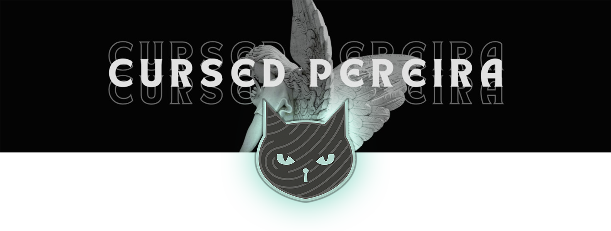

<h1 align="center">Steven Pereira aka Cursed
  
</h1>

  
  
  

I’m **Cursed** - a red team operator, offensive-security researcher, and cybersecurity educator.

I work at the intersection of **adversary simulation, purple teaming, application security, and detection-oriented offensive research**. My work is about more than finding vulnerabilities: it is about understanding how real attackers operate, validating whether defenses actually hold, and turning offensive insight into practical security improvements.

I build tooling, document methodology, write technical content, and continuously explore the evolving attack surface across enterprise systems, cloud environments, mobile applications, APIs, and modern client technologies.

> **Current research interests:** browser sandbox escape, Win32 API security scripting, adversary emulation, security-control evasion, and purple-team detection validation.

<h2 style="color: #C6ECE3;">About Me 🪪</h2>

#### 🚀 Senior Cybersecurity Manager at Nomura Holdings
- Specializing in penetration testing, red teaming, and security architecture reviews for high-profile clients
- Helping organizations identify and mitigate cybersecurity risks while improving their security posture
- Expert in developing custom security tools that enhance offensive security capabilities
- Conducting Cloud Security Assessments and delivering tailored cybersecurity strategies for businesses

#### 🎸 When I'm not testing defenses, you’ll find me:
- Smashing opponents on the badminton court
- Playing the ukulele for my pets
- Exploring new tech innovations, experimenting with creative coding projects, and testing cutting-edge tools
- Watching anime and diving into gaming to recharge and stay inspired

#### 🔒 My Mission
- Passionate advocate for privacy, open-source development, and cybersecurity awareness
- Empowering individuals and organizations to navigate the digital world securely
- Focused on promoting secure coding practices, data protection, and making the internet a safer place
- Actively contributing to the cybersecurity community through open-source security tools and thought leadership

<h3 style="color: #C6ECE3;">What you'll find here 🚀</h3>

- 🔧 Innovative Tools - Explore my Python-based cybersecurity projects designed to solve real-world security challenges. From network vulnerability scanning to cloud security assessments, my tools are built to enhance your offensive security capabilities and streamline penetration testing.
- 🛡️ Cybersecurity Projects - Discover a collection of penetration testing scripts and vulnerability assessment tools focused on network security, web application security, cloud security, and red teaming. These projects are built to address a variety of security needs, from external threat reconnaissance to system hardening.
- 💻 Development Experiments - Explore my coding experiments and tech projects, where I push the envelope in areas like AI integration, ethical hacking, and automation. These projects reflect my skills in software development, cybersecurity tool creation, and my passion for innovative solutions.
- 🌐 Open-Source Contributions - Check out my open-source contributions in cybersecurity, with a focus on security automation, threat intelligence, and cloud security posture management. I actively contribute to the cybersecurity community, ensuring that best practices and cutting-edge tools remain accessible to all.

<h3 style="color: #C6ECE3;">My Skills (Services) ⚔️</h3>

<table align="center">
<tr>
<td width="50%" valign="top">

#### Offensive Security

</td>
<td width="50%" valign="top">

#### Defensive Security Skills (Audits/Reviews)

</td>
</tr>
<tr>
<td width="50%" valign="top">

#### Coding Stack

</td>
<td width="50%" valign="top">

#### Operating Systems: 

</td>
</tr>
</table>

<h2 style="color: #C6ECE3;">Writing & Research ✍️</h2>

I write **rants, walkthroughs, and research notes** about the parts of security that do not fit neatly into a slide deck.

Mostly, I rant about broken assumptions, overcomplicated security advice, weak detection strategies, and the gap between how attacks actually work and how organizations think they work. Then I back it up with practical walkthroughs, technical research, and educational material that makes complex security concepts usable in the real world.

### What I Write

- **Rants** - blunt takes on security theater, bad practices, broken processes, and the realities of offensive security
- **Walkthroughs** - hands-on technical guides for exploitation, tooling, automation, and assessment workflows
- **Research notes** - ongoing notes on browser sandboxing, Windows internals, Win32 APIs, and modern attack surface
- **Educational content** - practical explanations designed to make offensive and defensive security concepts actually usable

### Selected Topics

- Red teaming and adversary simulation
- Purple teaming and detection engineering
- Mobile application and API security
- Cloud security and attack-path analysis
- Windows internals and Win32 API security
- Browser sandboxing and escape research
- Secure coding and security automation

<h2 style="color: #C6ECE3;">Currently 🎯</h2>

- 🔬 Researching browser sandbox escape techniques and modern client-side attack surface
- 🪟 Building Win32 API-focused security scripting and offensive tooling
- 🟣 Developing purple-team material that connects offensive actions to detection outcomes
- ✍️ Writing technical articles, assessment guides, and educational cybersecurity content
- 🧩 Exploring automation, AI-assisted security workflows, and creative coding experiments

<h2 style="color: #C6ECE3;">Let's Connect 🚀</h2>

I’m open to technical collaboration, security research, open-source work, speaking, writing, and meaningful conversations across offensive security, purple teaming, cloud security, and application security.

<h2 style="color: #C6ECE3;">Let's Play a Game 🐍</h2>

  

